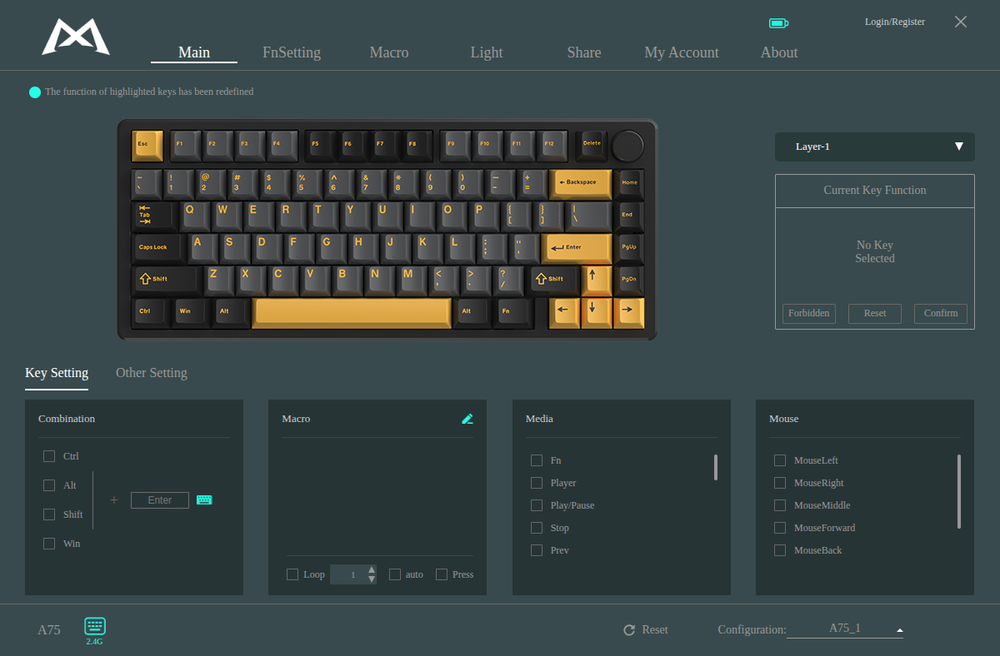

# Monkey Wrench 🔧

[](https://github.com/JimmYCHUU/MonkeyWrench/actions/workflows/ci.yml)


The Monka keyboard driver on Linux. The name is a play on Monka, and on the tool you reach for
when the vendor didn't ship one. Monka ships its configurator (key mapping, Fn layers,
macros, lighting, profiles) for Windows only. That configurator turns out to be an Electron
app whose whole interface is a web bundle, talking to a small native helper that does nothing
but relay USB HID feature reports. Monkey Wrench keeps the vendor's interface exactly as it is
and replaces the helper with a Node.js bridge that speaks the keyboard's protocol over Linux
`hidraw`. The result installs like any other desktop app: an RPM, a launcher entry, an icon,
a tray icon. It looks and behaves like the Windows driver because it *is* the Windows driver's
interface.

Built for and verified on the **Monka A75** over its 2.4 GHz dongle. Every other keyboard in
the vendor's device table is enumerated the same way, but only the A75 has been tested.

`Electron 44` · `Node.js 22+` · `node-hid (hidraw)` · `gRPC-web` · `protobufjs` · `rpmbuild`

<p align="center">
  
</p>

---

## Table of contents

- [The idea](#the-idea)
- [How it works](#how-it-works)
- [What was reverse-engineered](#what-was-reverse-engineered)
- [Install & run](#install--run)
- [Running from source](#running-from-source)
- [The read-only guard](#the-read-only-guard)
- [Verified on the A75](#verified-on-the-a75)
- [Behaviour worth knowing](#behaviour-worth-knowing)
- [Tools](#tools)
- [Tests](#tests)
- [Project layout](#project-layout)
- [Troubleshooting](#troubleshooting)
- [Status and limits](#status-and-limits)
- [Licence](#licence)

---

## The idea

Opening the Windows installer shows what the "driver" is: an electron-builder package with an
unpacked `resources/app` holding `main.js` (the Electron main process), `dist/index.html` plus
one 13 MB React bundle, the brand's logos and device photos, and `iot_driver.exe`. The
renderer builds every keyboard command itself, as 64-byte feature reports with the command in
byte 0, and sends them to `iot_driver.exe` over gRPC-web on `127.0.0.1:3814`. The helper pads
and checksums the frame, selects the right device behind a shared dongle, and reads the reply
back.

So the port is small on purpose. The vendor bundle is loaded unchanged (visual fidelity by
construction), the Electron main process is rewritten in about 200 lines for Linux, and the
helper is replaced by a bridge whose only real job is to reproduce the helper's wire behaviour
faithfully. That behaviour was recovered from the vendor's own macOS build of the helper, which
keeps its Rust symbol names, and then confirmed against the keyboard.

## How it works

```
Electron main (main.js)
  ├─ utilityProcess ── bridge/main.js        gRPC-web server on 127.0.0.1:3814 (text + binary framing)
  │                      ├─ service.js         the 21 DriverGrpc methods the vendor UI calls
  │                      ├─ hid/manager.js     device list, vendor events, feature I/O, dongle polling
  │                      │    ├─ devices.js    hidraw enumeration from sysfs + the helper's device table
  │                      │    ├─ frame.js      64-byte frame, BIT7 / BIT8 / NONE checksums
  │                      │    ├─ dongle.js     F7 status, F6 select, FE length, FC read prelude, 8F id
  │                      │    └─ guard.js      read-only gate (SET commands refused in dev runs)
  │                      ├─ kvstore.js         the UI's settings store (replaces the helper's sled db)
  │                      └─ sysinfo.js         CPU / memory / disk / network for keyboards with screens
  └─ BrowserWindow ──── dist/index.html       the vendor renderer, verbatim (1200×788, frameless)
```

- **Discovery.** `/sys/class/hidraw` is scanned once a second (cheap, no USB traffic). Each node's
  report descriptor is parsed for its top-level collections and matched against the device table
  embedded in the vendor helper (`bridge/hid/support_devices.json`). The A75 dongle's command
  channel is interface 2, usage page `0xFFFF` usage 2: one 64-byte feature report without report
  id. Its vendor event stream is interface 1, report id 5.
- **Transport.** node-hid's asynchronous API over hidraw, one serialised queue per device; the
  bridge prepends the report-id byte on write and strips it on read.
- **Dongle protocol.** Status is polled every two seconds with `F7` (battery, online, ready). Before
  a user command the bridge waits for *online + ready*, selects the keyboard with `F6 0A` (cached),
  sends the frame; before a reply it sends the `FC` prelude, waits 20 ms, then reads. The paired
  keyboard's model id comes from `FE 40` followed by `GET_INFOR` (`8F`) through the dongle: the A75
  answers `0x0790`, reported to the UI as `0x80000790`, which is how the renderer picks the A75
  entry from its table.
- **Security.** The bridge listens on loopback only, refuses any request with a web `Origin`
  (only the `file://` renderer, whose origin is `null`, is accepted), checks the `Host` header, and
  requires a per-launch bearer token that the Electron main process injects into the renderer's
  requests. Settings are stored under `~/.config/Monkey Wrench/iot_db`, and paths outside that
  directory are refused.

## What was reverse-engineered

[docs/protocol-re.md](docs/protocol-re.md) is the full write-up, with function addresses and
instruction-level evidence. The short version:

| Thing | Finding |
|---|---|
| Frame | message zero-padded to 64 bytes, command in byte 0 |
| `BIT7` checksum | byte 7 = NOT of the 8-bit sum of bytes 0..6 (USB); BLE devices shift the window by one |
| `BIT8` checksum | byte 8 = NOT of the 8-bit sum of bytes 0..7 |
| Reads | the raw 64-byte reply, byte 0 echoes the command |
| Dongle | `F7` status word, `F6` select (`0A` keyboard, `05` mouse), `FE len`, `FC` read prelude, `8F` id query |
| Lighting writes | the A75 class sends `SET_LEDPARAM` with `BIT8` (checksum at byte 8 keeps the RGB bytes intact) |
| Key remaps | single-key `SET_KEYMATRIX_SIMPLE` (`0x13`) with `BIT7` |
| Sleep | the A75 reports a 180 s 2.4 GHz idle timer; asleep means offline to the dongle |

## Install & run

Monkey Wrench does not redistribute Monka's interface. You extract it from the official Windows
driver you download yourself; the script reads the installer, nothing is installed on Windows.

```sh
git clone https://github.com/JimmYCHUU/MonkeyWrench.git
cd MonkeyWrench
npm install

# 1. the vendor UI, from the official Windows driver (A75.exe or the .zip that holds it)
npm run vendor:extract -- ~/Downloads/A75.exe

# 2. the RPM: electron-builder "dir" output, then rpmbuild inside a fedora:44 container
#    (the host needs node, docker and 7z; no rpmbuild, no sudo)
npm run dist

# 3. install it like any other package
sudo dnf install ./release/monkey-wrench-*.rpm
```

That gives you `/opt/monkey-wrench`, `/usr/bin/monkey-wrench`, "Monkey Wrench" in the launcher with
its icon, and a tray icon while it runs. Remove it with `sudo dnf remove monkey-wrench`. Installing it over the earlier `monka-driver`
package replaces that package, and your settings from `~/.config/Monka Driver` are copied across
on the first start.

The keyboard's `hidraw` nodes must be readable and writable by your user. On Fedora with the
usual `uaccess` rules for vendor `3151` nothing is needed; otherwise add
`/etc/udev/rules.d/70-monka.rules`:

```
SUBSYSTEM=="hidraw", ATTRS{idVendor}=="3151", MODE="0660", TAG+="uaccess"
```

## Running from source

```sh
npm start              # read-only: SET commands are refused and logged
npm run start:fake     # no hardware: a simulated A75 dongle answers the UI
npm run start:rw       # writes enabled, same as the installed app
```

Some IDE terminals export `ELECTRON_RUN_AS_NODE`, which makes the Electron binary behave like
plain Node; the scripts clear it. The bridge's log is `~/.config/Monkey Wrench/logs/bridge.log`
and records every frame sent and received.

## The read-only guard

Development runs must never change a keyboard that someone types on every day. The bridge
therefore has a gate, on by default for `npm start` and for the standalone bridge, that only
lets through the GET commands known to be pure reads (`0x80`, `0x83`–`0x8C`, `0x8F`,
`0x90`–`0x97`) and the dongle housekeeping bytes (`F1`, `F6`, `F7`, `FB`, `FC`, `FD`, `FE`).
Everything else is refused with a gRPC error and a log line. A range such as `0x80`–`0xBF` was
deliberately not used: the vendor's other keyboard classes keep a few writes above `0x80`.

The installed app runs without the gate: the person using the interface is the one changing
settings. `MONKA_READ_ONLY=1|0` overrides either default.

## Verified on the A75

All of this was done on a real A75 through its dongle, with the owner's permission for the
writes, and every write was reverted. A 45-frame GET-only snapshot of the keyboard's
configuration taken before the tests is byte-identical to the one taken after
([docs/verification](docs/verification)).

| What | How | Result |
|---|---|---|
| Discovery | dongle polled, model id queried | A75 found, id `0x80000790`, battery shown |
| Full configuration read | the UI's own start-up | firmware, lighting, every key-matrix layer and page, Fn layers, debounce, sleep time |
| Lighting write, direct | `SET_LEDPARAM` brightness −1 with `BIT8`, then the original bytes | accepted, restored |
| Lighting write, through the UI | Brightness slider down and back | two `SET_LEDPARAM` frames, restored |
| Key remap, through the UI | F12 → Media "Play/Pause", then Reset | the keyboard reported "Play/Pause" for F12, then F12 again |
| Nothing else changed | snapshot diff | `IDENTICAL (45 frames)` |

The window itself matches the Windows layout: 1200×788, frameless, the same pages, the same
fonts. The headings look like a serif font on Windows too, because the bundle asks for Apple's
PingFang fonts and Chromium falls back to its standard font on both systems.

## Behaviour worth knowing

- The battery percentage is shown next to Monka's battery icon in the top bar, in the same cyan
  as its fill bar, with a lightning bolt while the keyboard's cable is connected. Monka's own interface draws only the icon, and over the
  2.4 GHz dongle it is never told the keyboard is charging (on Windows too); Monkey Wrench reads
  both from the dongle's status reply and adds the label without touching Monka's files.

- The keyboard sleeps after 180 s idle. The dongle then reports it offline, the lights go off
  and the UI shows "Search Device..." until a key is pressed. That is the keyboard, not the
  driver, and it is the same on Windows.
- At start-up the vendor UI reads the whole configuration and then writes the lighting
  parameters it has just read straight back. In read-only mode that write is refused; in the
  installed app it is a no-op re-apply, as on Windows.
- The UI's cloud features (account, sharing, update check, weather for keyboards with screens)
  need the vendor's servers; everything local works without them. The installed bundle lives in
  `/opt` as root, so the UI's self-update cannot rewrite it.
- Bluetooth firmware updates are not supported on Linux; the OTA page refuses rather than
  pretending.

## Tools

Everything in `tools/` is a developer aid and nothing in it is packaged.

| Tool | Writes? | Purpose |
|---|---|---|
| `tools/snapshot.js frames.txt out.json` / `--diff a b` | no | GET-only configuration snapshot through the dongle, and a byte diff of two snapshots |
| `tools/hidprobe.js` | no | print raw `F7` status replies |
| `tools/readwhenawake.js 87 88` | no | wait for the keyboard to wake, then read the given GET commands |
| `tools/probe.js devlist` | no | talk to a running bridge over gRPC-web, like the UI does |
| `tools/wakewait.js` | no | wait for wake-up and do one GET round trip (validates framing) |
| `tools/write-test-light.js` | **yes** | brightness one step and back, read-verified |
| `tools/ui-test.js` | **yes** | drives the real window over the DevTools protocol (`--remote-debugging-port=9333`): slider down and back, F12 remap and reset |
| `tools/restore-lights.js` | **yes** | re-apply the lighting parameters the keyboard already reports |

## Tests

```sh
npm test
```

89 tests with `node:test`, no hardware needed: protobuf codec against hand-computed wire bytes,
gRPC-web framing in both formats with streaming and trailers, origin/host/token checks, the
checksum rules (including the worked example the keyboard later echoed), the dongle sequences
against a scripted dongle, the read-only guard, sysfs enumeration against a fake sysfs tree,
hotplug events, the HID wrapper against a fake device, the manager end to end, the settings
store, system information, and the XDG autostart entry.

## Project layout

```
main.js                 Electron main: window, tray, IPC, bridge lifecycle, token injection
migrate.js              one-time carry-over of settings and autostart from the former name
battery-overlay.js      the battery percentage / charging label injected next to Monka's icon
autostart.js            XDG autostart entry (Electron's API is macOS/Windows only)
bridge/
  main.js               bridge entry point (plain Node; also run by Electron's utilityProcess)
  grpcweb.js            HTTP/1.1 gRPC-web server: framing, CORS, origin/host/token checks
  driver.proto          the service and messages, reconstructed from the vendor bundle
  proto.js              protobufjs codec
  service.js            method implementations
  kvstore.js            settings store
  sysinfo.js            /proc sampler
  hid/                  devices, watcher, hidasync, frame, dongle, guard, manager, fake
packaging/              RPM spec, Docker rpmbuild wrapper, desktop entry, launcher, icons
scripts/extract-vendor.sh   pulls the UI out of the official Windows installer
tools/                  probes and verification scripts (see Tools)
test/                   node:test suites
docs/
  protocol-re.md        the reverse-engineered protocol, with evidence
  verification/         the A75 baseline and after-test snapshots and the write frames sent
  superpowers/          the design spec and the implementation plan
```

## Troubleshooting

- **"Search Device..." forever.** Press a key; the keyboard is asleep. If it stays, check that
  `/dev/hidraw*` is accessible (`ls -l /dev/hidraw*`) and look at the bridge log.
- **The window never appears.** Another instance is running (the tray icon), or port 3814 is held
  by a stale `node bridge/main.js`; the app does not fight it, it logs and shows the window
  without a bridge after ten seconds.
- **The UI says the driver needs an update.** It compares the bridge's reported version with its
  own; the bridge answers `1.7.5`, which the bundle treats as current. The update itself is not
  possible on Linux.

## Status and limits

Working and verified on one keyboard. Not implemented: the vendor helper's handling of
standalone 2.4 GHz receivers that are not "dongle common" devices (`FB`/`FD` waits), BLE
keyboards, music and screen lighting sync (acknowledged, nothing streamed), and OTA upgrades.
Macro recording uses the same write path as remapping but was not exercised. The deferred
review notes are in the commit history.

## Licence

Copyright (c) 2026 JimmYCHUU. Published to be read and studied; see [LICENSE](LICENSE). The
interface this project loads belongs to Monka and Rongyuan and is not part of the repository.
